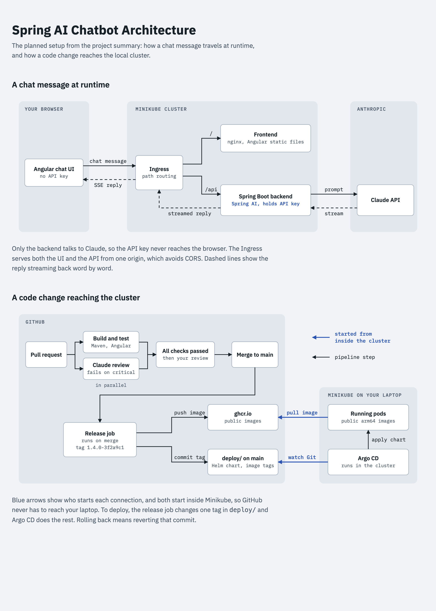

# Chatbot

A Spring AI chatbot with an Angular UI, reviewed by Claude and deployed to a local Minikube cluster with Argo CD.

## Layout

| Folder | Contents |
|---|---|
| `backend/` | Spring Boot service using Spring AI |
| `frontend/` | Angular chat UI |
| `deploy/` | Helm chart and image tags |

## Plan

The [project summary](AI%20Chatbots%2C%20Spring%20AI%20%26%20GitOps%20Pipeline%20%E2%80%93%20Summary.md) holds the decisions and the implementation plan (section 11).

