# How the Chatbot Works

This document explains the whole project: both apps, the cluster, the pipelines, and how Claude is built into them. It describes the state of `main` on 30 October 2026.

## Contents

1. [The big picture](#1-the-big-picture)
2. [Repo layout](#2-repo-layout)
3. [Backend internals](#3-backend-internals)
4. [Frontend internals](#4-frontend-internals)
5. [Running in Kubernetes](#5-running-in-kubernetes)
6. [The CI pipeline](#6-the-ci-pipeline)
7. [The release pipeline](#7-the-release-pipeline)
8. [GitOps with Argo CD](#8-gitops-with-argo-cd)
9. [How Claude is integrated](#9-how-claude-is-integrated)
10. [Keys, tokens and secrets](#10-keys-tokens-and-secrets)
11. [Safety and control](#11-safety-and-control)
12. [Costs](#12-costs)
13. [What went wrong and what it taught us](#13-what-went-wrong-and-what-it-taught-us)
14. [Commands you'll need](#14-commands-youll-need)
15. [Rebuild it stage by stage](#15-rebuild-it-stage-by-stage)
16. [Known gaps](#16-known-gaps)

## 1. The big picture

The project has two separate flows. Keep them apart in your head and everything else gets easier:

- **Runtime:** a person chats with the bot.
- **Delivery:** a code change travels from a PR to the running app.

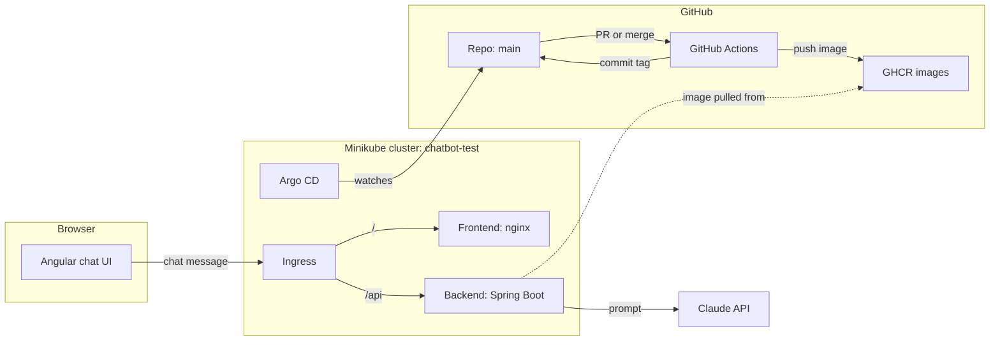

| Part | Technology | Version |
|---|---|---|
| Backend | Java, Spring Boot, Spring AI, WebFlux | Java 21, Boot 4.1.2, Spring AI 2.0.2 |
| Frontend | Angular, served by nginx | Angular 22 |
| Packaging | Docker, Helm | arm64 images |
| Cluster | Minikube on a Mac (Docker driver) | Kubernetes 1.37 |
| Deployment | Argo CD | v3.5.6 |
| Pipelines | GitHub Actions | `ci.yml`, `release.yml` |
| Image registry | GitHub Container Registry (GHCR) | Public images |
| AI | Claude API and Claude Code action | See section 9 |

## 2. Repo layout

Everything lives in one public repo: [mattuttis/chatbot](https://github.com/mattuttis/chatbot).

```text
chatbot/
├── .github/workflows/
│   ├── ci.yml                 Runs on every PR
│   └── release.yml            Runs on merges that change the apps
├── backend/                   Spring Boot service
├── frontend/                  Angular app
├── deploy/
│   ├── argocd/application.yaml   Tells Argo CD what to deploy
│   ├── chart/                    Helm chart for both apps
│   └── envs/test/values.yaml     Image tags, only on the release/test branch
├── AI Chatbots, ... Summary.md   Decisions and the implementation plan
├── architecture.png, ci-pipeline.png   Diagrams
└── how-it-works.md            This document
```

## 3. Backend internals

The backend is small on purpose. It accepts a message, passes it to Claude and streams the reply back.

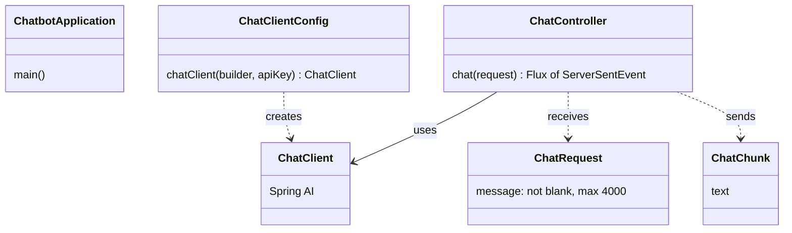

| File | Job |
|---|---|
| `ChatbotApplication` | Starts the app |
| `ChatClientConfig` | Builds the Spring AI `ChatClient`, and stops the app at startup if `ANTHROPIC_API_KEY` is missing |
| `ChatController` | Handles `POST /api/chat`, streams the reply, and turns failures into a safe error message |
| `ChatRequest` | The incoming message, with its validation rules |
| `ChatChunk` | One piece of the reply |
| `application.yml` | Model, token limit, API key and health check settings |

### A chat request, step by step

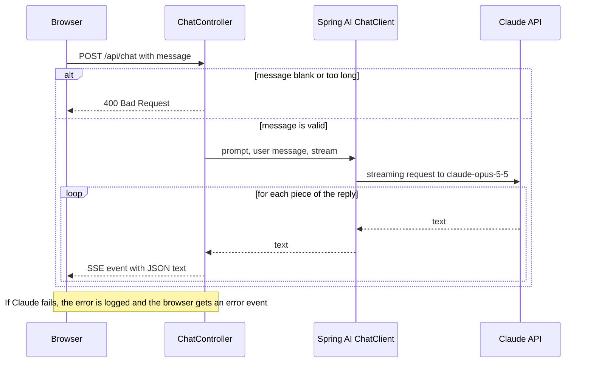

### Why it's built this way

- **Reactive stack:** Spring WebFlux returns a `Flux`, a stream of values that arrive over time. That suits streaming, because no thread sits waiting for Claude.
- **Server-Sent Events (SSE):** a one-way stream from server to browser over normal HTTP. It's simpler than WebSockets, and the chat only needs one direction.
- **JSON chunks:** SSE clients strip the leading space from plain text, so `" world"` would become `"world"` and words would run together. Wrapping each piece as `{"text":" world"}` keeps the spaces.
- **Error events:** the stream has already started with status 200 by the time Claude can fail, so a normal HTTP error isn't possible. The controller logs the real error and sends a generic `event:error`, so internal details never reach the browser.
- **Startup check:** a missing key stops the app immediately, rather than failing on the first chat.
- **Health checks:** Spring Boot Actuator provides `/actuator/health/readiness` and `/actuator/health/liveness` for Kubernetes. Other Actuator endpoints stay closed.
- **No chat memory:** each message stands alone, so Claude doesn't remember earlier messages.

### Tests

`mvn verify` runs 6 tests with Claude mocked, so no API key or credit is needed:

- `ChatControllerTest` covers streaming, the error event, a blank message and a message over the size limit.
- `ChatbotApplicationTest` starts the whole app and checks both health endpoints.

## 4. Frontend internals

The frontend is a single Angular page. Its code runs in the browser. nginx only delivers the files and never sees a chat message.

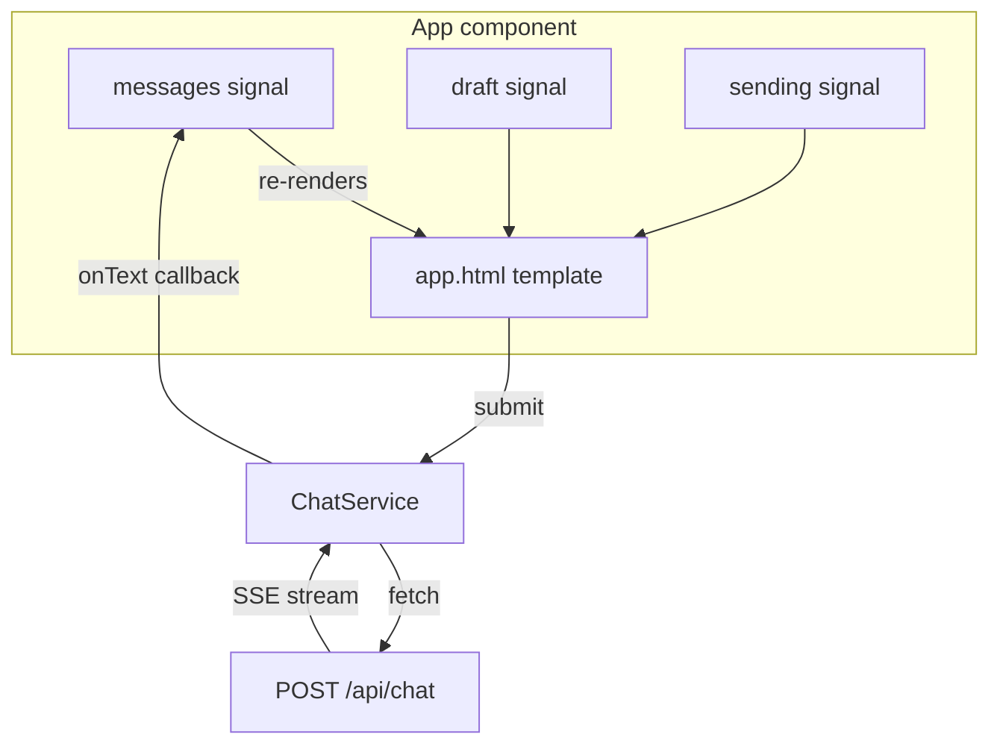

| File | Job |
|---|---|
| `app.ts` | Holds the page state in signals and handles sending |
| `app.html` | Shows the messages and the input form |
| `chat.service.ts` | Calls the API and reads the stream |
| `app.spec.ts`, `chat.service.spec.ts` | 7 tests, with the backend mocked |
| `nginx.conf` | Serves the app, and sends unknown paths to `index.html` |
| `proxy.conf.json` | Sends `/api` to `localhost:8080` during `npm start` |

### How a reply reaches the screen

1. `send()` adds your message and an empty reply to `messages`. An empty reply shows as `…`.
2. `ChatService.send()` calls `/api/chat` with `fetch`. It can't use `EventSource`, the browser's built-in SSE client, because `EventSource` only supports GET.
3. The service reads the response as a stream of text and keeps a buffer, because a network chunk can end in the middle of an event.
4. Each complete event is split off at the blank line and parsed as JSON.
5. Each piece is added to the last message, and Angular updates the screen.
6. An `event:error` or a bad status becomes a red error bubble.

Signals are Angular's way of tracking state. When a signal changes, Angular updates only what depends on it. The project uses zoneless mode, so signals drive all the screen updates.

## 5. Running in Kubernetes

Helm turns the templates in `deploy/chart` and the tags in `deploy/envs/test/values.yaml`, both from the `release/test` branch, into these resources:

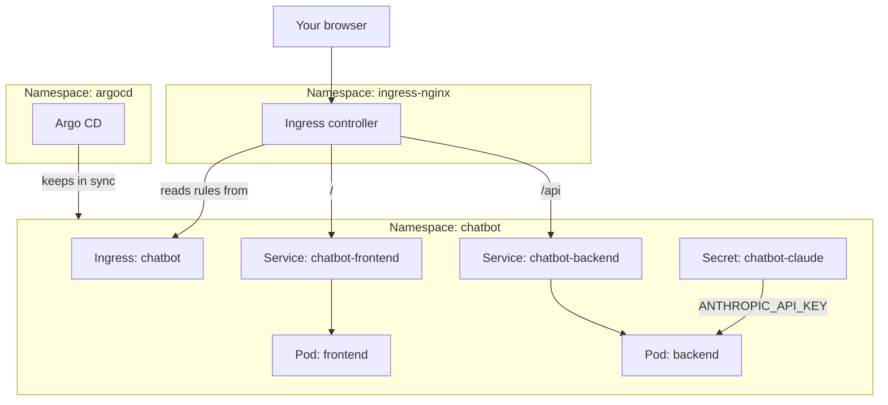

- **Pod:** a running container.
- **Deployment:** keeps the right number of pods running, and replaces them during an update.
- **Service:** a stable address for pods, which come and go.
- **Ingress:** routing rules. `/api` goes to the backend and everything else to the frontend. Using one address for both means the browser has no CORS problems.
- **Secret:** holds the API key inside the cluster. It's created by hand, because everything in Git is public.
- **Probes:** readiness decides whether a pod gets traffic, and liveness decides whether it gets restarted.

Three settings are easy to miss:

- `proxy-buffering: "off"` on the Ingress. Without it, nginx would collect the whole reply before sending it, which defeats the streaming.
- `proxy-read-timeout: "300"`, so a long reply isn't cut off.
- `runAsNonRoot: true`, so neither container runs as root. The images use a numeric user, because Kubernetes can't verify a user name.

**Arm64 matters.** Your Mac is an M4 Pro, so Minikube runs arm64. An image built for amd64 would fail with `exec format error`, so the release pipeline runs on GitHub's `ubuntu-24.04-arm` runner.

## 6. The CI pipeline

`ci.yml` runs on every PR to `main`. It answers one question: is this change safe to merge?

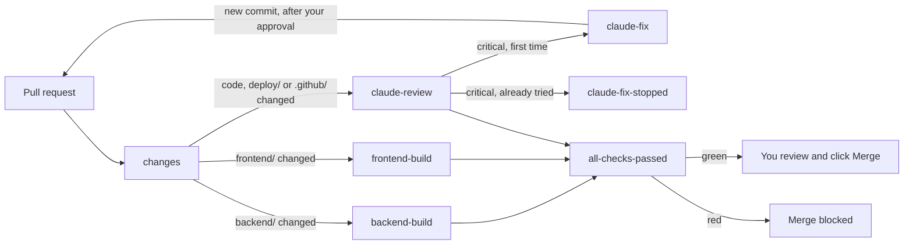

| Job | What it does | When it runs |
|---|---|---|
| `changes` | Works out which folders changed | Always |
| `backend-build` | `mvn verify` | `backend/` changed |
| `frontend-build` | `npm ci`, tests, production build | `frontend/` changed |
| `claude-review` | Reviews the diff and gives a verdict | `backend/`, `frontend/`, `deploy/` or `.github/` changed, and not from a fork |
| `claude-fix` | Tries one fix | The review found a critical issue, first time on this PR |
| `claude-fix-stopped` | Asks a person to step in | The review found a critical issue, and the fix was already tried |
| `notify-review` | Posts the verdict to Slack | After every review |
| `all-checks-passed` | The single gate | Always |

**Why one gate job?** A required check that never runs stays pending forever, and the PR can't merge. So `all-checks-passed` always runs, and it accepts skipped jobs. It fails only if a job failed or was cancelled.

**Why not `paths:` filters on the workflow?** They'd skip the whole workflow, including the gate. Using a `changes` job keeps the workflow running and skips only the jobs that aren't needed.

**The rule on `main`** is a GitHub ruleset called `Protect main`:

- A PR is required.
- 0 approvals are required, because GitHub doesn't let you approve your own PR. Your click on Merge is the human approval.
- `all-checks-passed` must be green.
- No force-pushes and no branch deletion.

**Slack messages** go to the private channel `#chatbot-dev` through one webhook:

| Message | Sent by | When |
|---|---|---|
| 🆕 PR opened | `notify.yml` | A PR to `main` is opened |
| ✅ Claude accepted | `notify-review` in `ci.yml` | The review passes |
| ❌ Claude found critical issues | `notify-review` | The review finds a critical issue |
| ⚠️ Claude review failed | `notify-review` | The review stops without a verdict |
| 🚀 PR merged | `notify.yml` | A PR is really merged, not just closed |

The review runs on every push, so a PR can post several verdicts. Docs-only PRs skip the review, so they only post opened and merged. PRs from forks post nothing, because they can't read the webhook secret.

Neither job is part of `all-checks-passed`, so a Slack problem can't block a merge. It only shows as a failed job on the PR.

## 7. The release pipeline

`release.yml` runs when a merge changes `backend/`, `frontend/` or `deploy/chart/`. It doesn't rerun the tests, because CI already ran them on the PR.

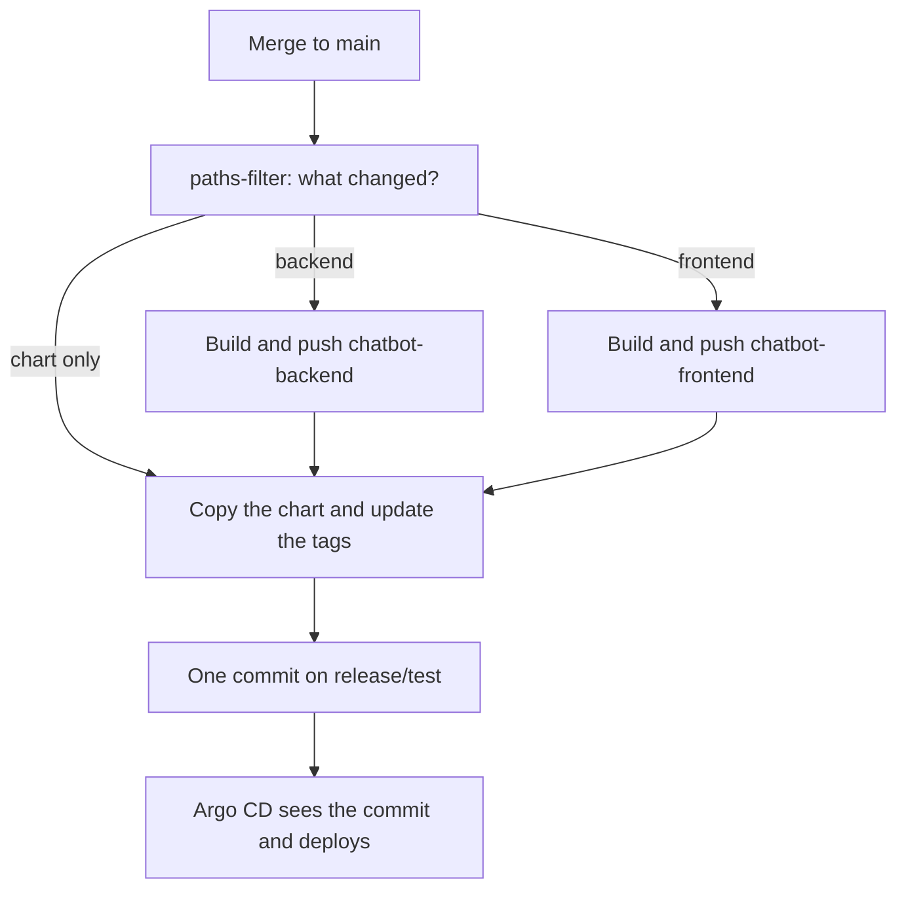

- **Chart and image arrive together:** Argo CD watches `release/test`, not `main`, and only this pipeline updates that branch. The chart and new tags land in one commit, after the images exist.
- **One job on purpose:** the release branch is updated only at the very end. If one image fails, nothing deploys, so a change that needs both apps can't deploy halfway. A failed run can leave an unused image behind, and a rerun fixes that.
- **Image tags:** version plus commit, such as `0.1.0-2e78a63`. Every release gets a unique tag. `latest` would be a mistake here, because Argo CD wouldn't see a change.
- **No loop:** this workflow only runs on `main`, and it commits to `release/test`.
- **One at a time:** `concurrency: release` stops two merges from racing on the release branch.
- **Simple credentials:** `release/test` isn't locked, so the built-in `GITHUB_TOKEN` can push to it.

The two pipelines at a glance:

| | CI (`ci.yml`) | Release (`release.yml`) |
|---|---|---|
| **Trigger** | PR to `main` | Merge that changes an app or the chart |
| **Question** | Is this safe to merge? | What's the new version? |
| **Result** | A green or red check | Images and a commit on `release/test` |
| **Tests** | Yes | No, already done |
| **Changes `main`** | No | No |

## 8. GitOps with Argo CD

**GitOps** means Git holds the desired state of the cluster. Nobody runs `helm upgrade` by hand. Argo CD runs inside the cluster and keeps it matching Git.

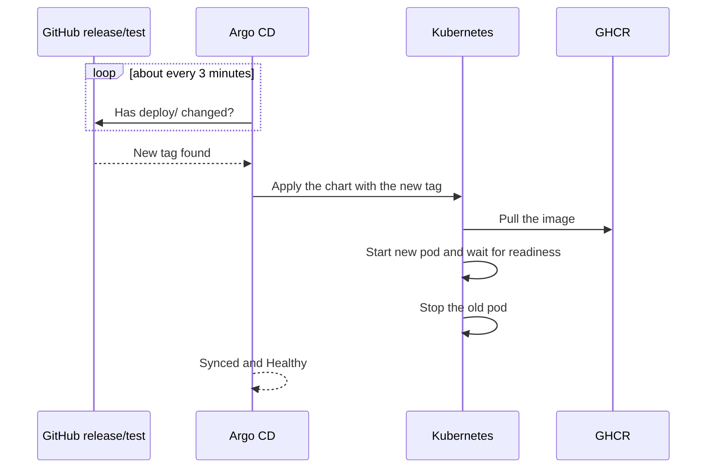

- **Everything starts inside the cluster.** Argo CD and Kubernetes connect out to GitHub, so GitHub never needs to reach your laptop. That's why this works on a local Minikube.
- **`automated` sync:** changes in Git deploy without a click.
- **`selfHeal`:** if someone changes the cluster by hand, Argo CD puts it back.
- **`prune`:** resources removed from Git are removed from the cluster.
- **Rollback is a Git revert on `release/test`.** It needs no PR, so it's fast, but it also skips the checks. Our earlier rollbacks took 47 and 73 seconds. The image you return to must support the chart you return to, and a revert brings both back.

Updates took between 2 and 5 minutes from tag commit to running pod, with no manual refresh. It varies because Argo CD checks Git on a timer.

## 9. How Claude is integrated

Claude is used in **two unrelated ways**, with different credentials and different billing. This is the part that's easiest to mix up.

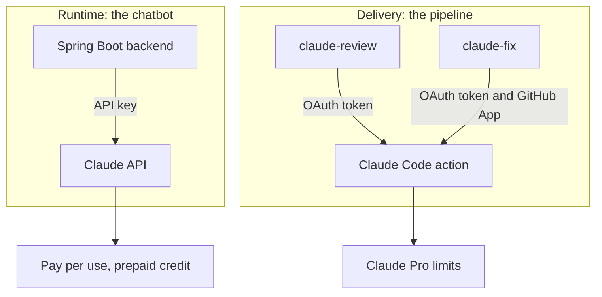

| | Chatbot | CI review and auto-fix |
|---|---|---|
| **What runs** | Your Spring Boot code | `anthropics/claude-code-action@v1` |
| **Model** | `claude-opus-5-5`, set in `application.yml` | The action's default, Sonnet in our runs |
| **Credential** | API key from console.anthropic.com | OAuth token from `claude setup-token` |
| **Stored in** | Kubernetes Secret | GitHub Actions secret |
| **Billing** | Your prepaid API credit | Your Pro usage limits |

### Connecting Claude to the backend

1. Add the `spring-ai-starter-model-anthropic` dependency.
2. Set the model and token limit in `application.yml`, and read the key from `ANTHROPIC_API_KEY`.
3. Let Spring AI auto-configure a `ChatClient.Builder`, and build the client from it.
4. Call `chatClient.prompt().user(message).stream().content()`.

A Pro subscription doesn't include API access, so the key is a separate purchase.

### How the Claude review works

1. Run `claude setup-token` and store the result as the `CLAUDE_CODE_OAUTH_TOKEN` secret.
2. The job passes the prompt to the action. Its `--allowedTools` limit Claude to reading the PR and posting comments.
3. Claude reads the diff with `gh pr diff`, and posts inline comments and a summary.
4. `--json-schema` makes Claude return a fixed answer: `{"critical_issues": true}` or `false`.
5. The next step reads that value and fails the job if it's `true`.

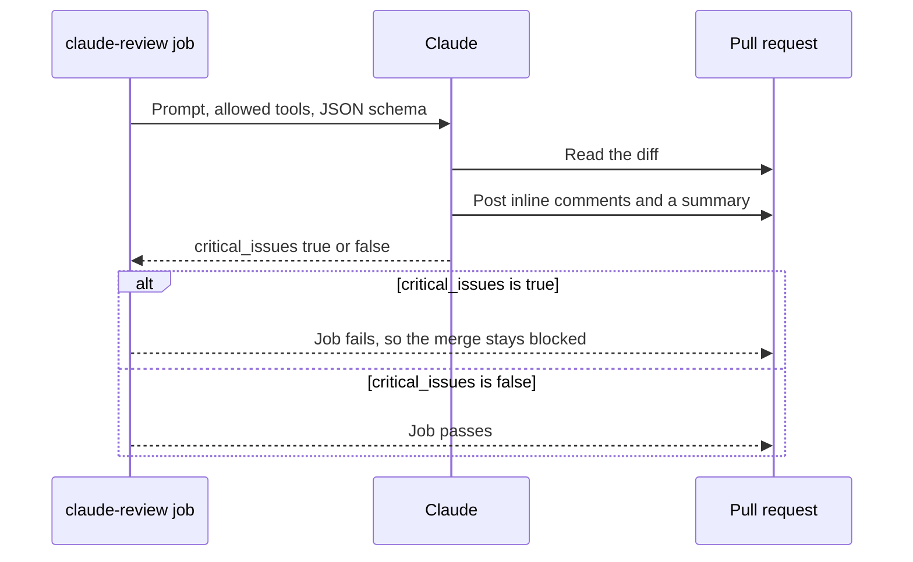

Why the verdict? The Claude action only comments by default. A prompt saying "fail the job" can't reliably change a job's result, but a workflow step reading a fixed JSON value can. A critical issue means a leaked secret, a security hole, data loss, or code that can't work. Everything else stays a comment and doesn't block.

### How the auto-fix works

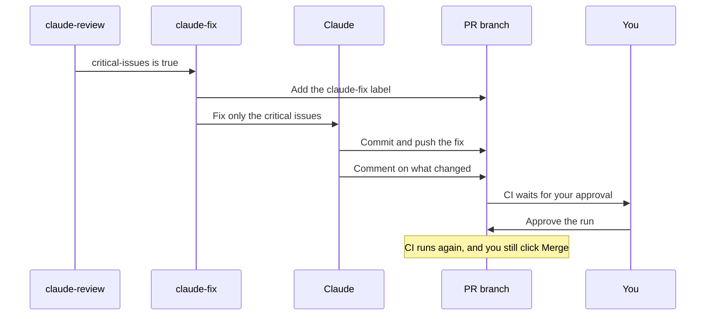

Each part has a reason:

- **The Claude GitHub App:** commits pushed with `GITHUB_TOKEN` don't start new workflows. The fix uses the App's token, so its commit can start CI.
- **`id-token: write`:** lets the action exchange a GitHub identity token for the App's token.
- **The `claude-fix` label:** limits Claude to one attempt per PR.
- **`claude-fix-stopped`:** if critical issues remain, it comments and asks you to step in.
- **Push check:** the action can succeed without pushing anything, so a final step compares the branch with the original commit. If nothing changed, the job fails and comments.
- **`allowed_bots: claude,github-actions`:** bots can't trigger the action by default, so this lets the review run on the fix commit. The fix commit arrives as `github-actions`, so that name is needed too. Only the review job has this setting, and it can't push code.
- **Allowed tools:** Claude can edit files and use a short list of `git` and `gh` commands. `git rm` is on that list because a fix may need to delete a file.
- **No fix on forks:** the review is skipped on fork PRs, so `claude-fix` never gets a critical result to act on.
- **Your approval:** GitHub treats the bot as an external contributor, so CI on its commit waits for you. That's the extra stop you wanted.

One limit to know: a PR that changes the workflow can't use the App's token, because the action checks that the workflow matches `main`. That's why the auto-fix could only be tested after merging it.

## 10. Keys, tokens and secrets

No secret lives in Git or in an image.

| Name | What it is | Stored in | Used by | Lasts |
|---|---|---|---|---|
| Anthropic API key | Pays for the chatbot's Claude calls | 1Password and Kubernetes Secret `chatbot-claude` | Backend | Until you revoke it |
| `CLAUDE_CODE_OAUTH_TOKEN` | Runs Claude in CI on your Pro plan | GitHub Actions secret | `claude-review`, `claude-fix` | 1 year |
| `GITHUB_TOKEN` | Temporary token for each run | Created by GitHub | Most jobs | One run |
| Claude GitHub App | Lets fix commits start CI | Installed on this repo | `claude-fix` | Until you remove it |
| `SLACK_WEBHOOK_URL` | Lets anyone holding it post to `#chatbot-dev` | GitHub Actions secret | `notify.yml`, `notify-review` | Until you remove the webhook |

## 11. Safety and control

| Risk | What protects you |
|---|---|
| Bad code reaches `main` | PR required, checks required, and only you can click Merge |
| A stranger's PR runs CI | You must approve the run, and it gets no secrets |
| A stranger's PR uses your Claude limits | The review is skipped on fork PRs |
| The bot changes too much | It can't push to `main`, and it only writes to `release/test` |
| Claude's fix goes wrong | One attempt, your approval to run CI, and your Merge click |
| A release breaks the app | The new pod must pass its checks, or the old one keeps serving, and rollback is a revert |
| The API key leaks | It's outside Git and images, and the budget is prepaid |

**Nothing merges automatically.** Auto-merge is off. Every commit on `main` comes through a PR. `release/test` isn't protected, so anyone with write access could push to it, and today that's only you and the pipeline.

Read any change under `.github/` carefully, because workflows are what can use your secrets. Keep using `pull_request`, not `pull_request_target`, which would give fork PRs access to secrets.

## 12. Costs

| Item | Cost |
|---|---|
| GitHub Actions, including arm64 runners on a public repo | Free |
| Public images on GHCR | Free |
| Minikube, Helm, Argo CD | Free |
| Claude reviews and fixes | Included in Pro, and they count against your limits |
| Chatbot messages | Your API credit |

Opus costs $4 per million input tokens and $20 per million output tokens. `claude-haiku-5-5` costs far less, and you can switch to it in `application.yml`. Check that auto-reload is off in console.anthropic.com, so the prepaid credit stays the limit.

## 13. What went wrong and what it taught us

These problems are the most useful part of the day, and good material for an interview or a video.

| Problem | Cause | Fix | Lesson |
|---|---|---|---|
| `401 Invalid bearer token` in CI | The token was damaged when copied from a wrapped terminal line | Strip whitespace with `tr` before `gh secret set` | Check that a secret works, not just that it exists |
| OAuth `client_id` error | The sign-in URL was also broken by line wrapping | Use a wider terminal | Terminals wrap long values |
| Merge could get stuck | A required check whose workflow doesn't run stays pending | Always-running gate job | Design around skipped jobs |
| Bot couldn't push to `main` | `GITHUB_TOKEN` can't go on the exception list | A deploy key at first, then a separate `release/test` branch | Test assumptions early, and removing a need beats working around it |
| Secret held `kubectl...` | The clipboard still held the command | `op read` from 1Password | Verify a secret's start, not all of it |
| First auto-fix did nothing | No allowed tool could delete a file | Add `git rm` | Allowed tools limit what Claude can do |
| Review stopped on a fix commit | The commit came from `github-actions`, which wasn't an allowed bot (`Workflow initiated by non-human actor`) | Add it to `allowed_bots` | Check which identity a commit really uses |
| Fix job reported success with no commit | A denied action doesn't fail the job | A step that checks a commit was pushed | A green job doesn't prove the work happened |
| New pod failed briefly | Chart arrived before its image | Accepted for test, see section 16 | Chart and image can arrive at different times |
| Rollback plan wouldn't work | The old image had no health endpoint | Roll back to a newer image | A chart change can make old images unusable |
| First startup check did nothing | An unresolved placeholder doesn't stop Spring | Explicit check in code, then tested by hand | Run the failure case, not just the tests |

## 14. Commands you'll need

**Run the backend locally**

```bash
cd backend
export ANTHROPIC_API_KEY=$(op read "<secret reference>")
mvn spring-boot:run
```

**Run the frontend locally**

```bash
cd frontend
npm install
npm start
```

**Run the tests**

```bash
(cd backend && mvn verify)
(cd frontend && npm test -- --watch=false)
```

**Open the deployed app**

```bash
kubectl -n ingress-nginx port-forward svc/ingress-nginx-controller 8088:80
```

Then open <http://localhost:8088>. You can also use `minikube tunnel -p chatbot-test`, which needs your password.

**See what's happening**

```bash
kubectl -n chatbot get pods
kubectl -n chatbot logs deploy/chatbot-backend
kubectl -n argocd get application chatbot
```

**Open the Argo CD UI**

```bash
kubectl -n argocd port-forward svc/argocd-server 8080:443
kubectl -n argocd get secret argocd-initial-admin-secret -o jsonpath='{.data.password}' | base64 -d
```

Then open <https://localhost:8080> and sign in as `admin`.

**Rebuild the cluster from scratch**

```bash
minikube start -p chatbot-test
minikube addons enable ingress -p chatbot-test
kubectl create namespace argocd
kubectl apply -n argocd --server-side -f https://raw.githubusercontent.com/argoproj/argo-cd/v3.5.6/manifests/install.yaml
kubectl -n argocd rollout status deploy/argocd-server
kubectl create namespace chatbot
kubectl create secret generic chatbot-claude -n chatbot --from-literal=api-key="$(op read "<secret reference>")"
kubectl apply -f deploy/argocd/application.yaml
```

Argo CD then deploys everything else from Git. Nothing in the cluster is unique except the Secret, which you recreate from 1Password.

**Check a Secret without showing it**

```bash
kubectl get secret chatbot-claude -n chatbot -o jsonpath='{.data.api-key}' | base64 -d | cut -c1-7; echo
```

It should print `sk-ant-`.

## 15. Rebuild it stage by stage

This is the path to get from nothing to the current state. Each stage ends with a check, so you know you've arrived before moving on. Replace `<your-user>` with your GitHub name.

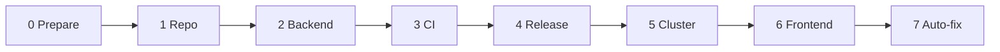

### Stage 0: Prepare

**You need**

- A Mac or Linux machine, with Java 21, Maven, Node, Docker, kubectl, Helm, Minikube and the GitHub CLI (`gh`)
- A GitHub account, signed in with `gh auth login`
- A Claude Pro plan for the reviews
- An API key with credit from console.anthropic.com for the chatbot
- Optional: the 1Password CLI (`op`), with the app's CLI integration turned on

**Check it**

```bash
java -version && mvn -v && node -v && docker info --format '{{.Architecture}}' && gh auth status
```

Note the architecture. On Apple Silicon, it's arm64, and your images must match.

### Stage 1: Repo

1. Create the folders `backend/`, `frontend/` and `deploy/`. Add a `.gitkeep` to each, because Git doesn't track empty folders.
2. Add a README and a `.gitignore` covering `target/`, `node_modules/`, `.env` and your IDE files.
3. Create and push the repo:

```bash
git init -b main
git add -A
git commit -m "Set up monorepo layout"
gh repo create <your-user>/chatbot --public --source=. --remote=origin --push
```

**You've arrived when** the repo is on GitHub with those folders. Nothing is protected yet, so this first push can go straight to `main`.

### Stage 2: Backend

1. Create a branch: `git switch -c feature/chatbot-backend`.
2. Create a Spring Boot project in `backend/` with WebFlux, Validation, Actuator and `spring-ai-starter-model-anthropic`.
3. Add the classes from section 3, and the model and key settings in `application.yml`.
4. Write the tests, with `ChatClient` mocked.
5. Run it:

```bash
cd backend
mvn verify
export ANTHROPIC_API_KEY=$(op read "<secret reference>")
mvn spring-boot:run
```

6. In a second terminal, send a message:

```bash
curl -N -X POST localhost:8080/api/chat -H 'Content-Type: application/json' -d '{"message":"Say hello"}'
```

**You've arrived when** `mvn verify` passes and the reply arrives in `data:` pieces.

### Stage 3: CI

1. Add `.github/workflows/ci.yml` with `changes`, `backend-build`, `claude-review` and `all-checks-passed`. See section 6.
2. Create the token in a maximized terminal, copy it, then store it with any line breaks removed:

```bash
claude setup-token
pbpaste | tr -d '[:space:]' | gh secret set CLAUDE_CODE_OAUTH_TOKEN -R <your-user>/chatbot
```

3. Push the branch and open a PR.
4. Protect `main` with a ruleset. Save this as `ruleset.json`:

```json
{
  "name": "Protect main",
  "target": "branch",
  "enforcement": "active",
  "conditions": { "ref_name": { "include": ["~DEFAULT_BRANCH"], "exclude": [] } },
  "rules": [
    {
      "type": "pull_request",
      "parameters": {
        "required_approving_review_count": 0,
        "dismiss_stale_reviews_on_push": false,
        "require_code_owner_review": false,
        "require_last_push_approval": false,
        "required_review_thread_resolution": false
      }
    },
    {
      "type": "required_status_checks",
      "parameters": {
        "strict_required_status_checks_policy": false,
        "required_status_checks": [{ "context": "all-checks-passed" }]
      }
    },
    { "type": "non_fast_forward" },
    { "type": "deletion" }
  ]
}
```

```bash
gh api -X POST repos/<your-user>/chatbot/rulesets --input ruleset.json
```

5. Require your approval for outside contributors, under **Settings > Actions > General > Require approval for all external contributors**.
6. Test the block with a throwaway PR containing a deliberate security hole. Close it without merging.
7. Review and merge the real PR.

**You've arrived when** the clean PR goes green and the test PR shows `BLOCKED`.

### Stage 4: Release

1. Create a branch, and add `backend/Dockerfile`.
2. Add the chart in `deploy/chart/`.
3. Add `.github/workflows/release.yml`, and add `deploy/` to the review filter in `ci.yml`.
4. Create the `release/test` branch from `main`, and add the first tags to `deploy/envs/test/values.yaml` on that branch only:

```bash
git switch -c release/test
mkdir -p deploy/envs/test
printf 'backend:\n  image:\n    tag: "0.1.0-initial"\n' > deploy/envs/test/values.yaml
git add -A && git commit -m "Add test environment values"
git push -u origin release/test
git switch -
```

5. Check it locally, then open a PR and merge it:

```bash
helm lint deploy/chart --set backend.image.tag=test
docker build -t chatbot-backend:local backend
```

**You've arrived when** the Release run passes, a `Deploy chatbot...` commit appears on `release/test`, and this works with no login:

```bash
docker logout ghcr.io
docker pull ghcr.io/<your-user>/chatbot-backend:<tag>
```

### Stage 5: Cluster

1. Run the first 5 commands under "Rebuild the cluster from scratch" in section 14, up to the Argo CD rollout check.
2. Create the namespace and Secret:

```bash
kubectl create namespace chatbot
kubectl create secret generic chatbot-claude -n chatbot --from-literal=api-key="$(op read "<secret reference>")"
```

3. Add `deploy/argocd/application.yaml` through a PR, and update `repoURL` if your repo has a different name.
4. After the merge, apply it:

```bash
kubectl apply -f deploy/argocd/application.yaml
kubectl -n argocd get application chatbot
```

5. Test an update: merge a small `backend/` change, and wait for the new pod.
6. Test a rollback: on `release/test`, run `git revert --no-edit HEAD`, then push.

**You've arrived when** Argo CD shows `Synced` and `Healthy`, and a merge updates the pod with no manual step.

### Stage 6: Frontend

1. Create a branch, and generate the project:

```bash
npx @angular/cli@latest new chatbot-frontend --directory frontend --routing=false --style=css --ssr=false --skip-git --zoneless --ai-config=none --defaults
```

2. Add the chat page and `ChatService` from section 4, with tests.
3. Add `frontend/Dockerfile`, `nginx.conf` and `.dockerignore`.
4. Add the frontend Deployment, Service and Ingress to the chart.
5. Add `frontend-build` to `ci.yml`, and to the jobs `all-checks-passed` waits for.
6. Add the frontend to `release.yml`.
7. Check it, then open a PR and merge it:

```bash
(cd frontend && npm test -- --watch=false && npm run build)
docker build -t chatbot-frontend:local frontend
```

8. The frontend pod shows `ImagePullBackOff` until its first image is built. That's expected.
9. Open the app using the port-forward in section 14, and send a message.

**You've arrived when** the reply appears word by word in your browser.

### Stage 7: Auto-fix

1. Install the Claude GitHub App on this repo only: [github.com/apps/claude](https://github.com/apps/claude).
2. Create the label:

```bash
gh label create claude-fix -R <your-user>/chatbot --color 0f5cc0
```

3. Add `claude-fix` and `claude-fix-stopped` to `ci.yml`, and `allowed_bots: claude,github-actions` to the review. See section 9.
4. Merge that through a PR. The fix job can't be tested before it's on `main`.
5. Test it with a throwaway PR containing a deliberate critical bug. When CI waits on Claude's commit, approve the run.
6. Push the bug again to that branch, and check that Claude asks for a person instead of trying twice.
7. Close the test PR without merging.

**You've arrived when** Claude's fix commit appears on the PR, and the second bug produces the "fix them by hand" comment.

## 16. Known gaps

**Before going public**

- `/api/chat` has no login or rate limit, so anyone who can reach it can spend your API credit.
- A real hosted environment is needed. The current one stops when your laptop does.

**App**

- There's no chat memory.
- Refused requests may show an empty reply, because Claude's automatic fallback isn't enabled.
- Replies can't be cancelled, and nginx has no security headers yet.

**Cluster state**

- The backend runs `0.1.0-d40564c` after the rollback test, so the `Chat client ready` log line on `main` isn't deployed yet. The next backend merge moves it forward.
- The frontend runs `0.1.0-2e78a63` after the demo rollback, so the page says "Chatbot", while `main` says "Software Factory". The next frontend merge moves it forward.

**Housekeeping**

- Renew `CLAUDE_CODE_OAUTH_TOKEN` within a year.
- Tidy the summary doc's wording: "master", "API key or token" and the `minikube tunnel` advice.
